# TECHNICAL FLOWCHART — RO Proposal Studio (working title)

Companion to `PRD.md`, `TRD.md`, `DESIGN.md`.

All diagrams are in Mermaid. They render in GitHub, VS Code (Mermaid preview extension), Google AI Studio / most Markdown viewers, and at https://mermaid.live (paste the code block).

Contents
1. System architecture
2. Offline-first data flow
3. Sync sequence
4. Reference-number reservation
5. Proposal creation flow
6. Multimedia filter calculation flow
7. Cartridge filter calculation flow
8. PDF generation pipeline
9. Proposal status state machine
10. Revision and duplicate flow
11. Data model (ER overview)
12. Deployment and CI flow

---

## 1. System architecture

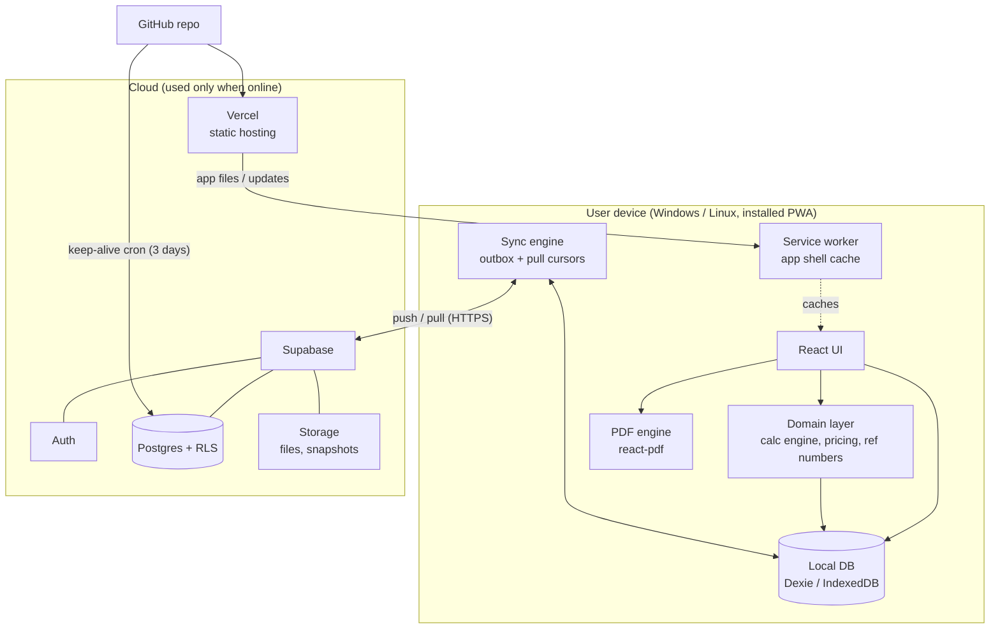

---

## 2. Offline-first data flow

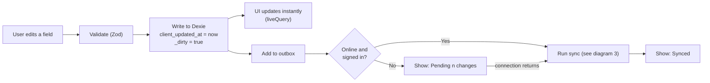

---

## 3. Sync sequence

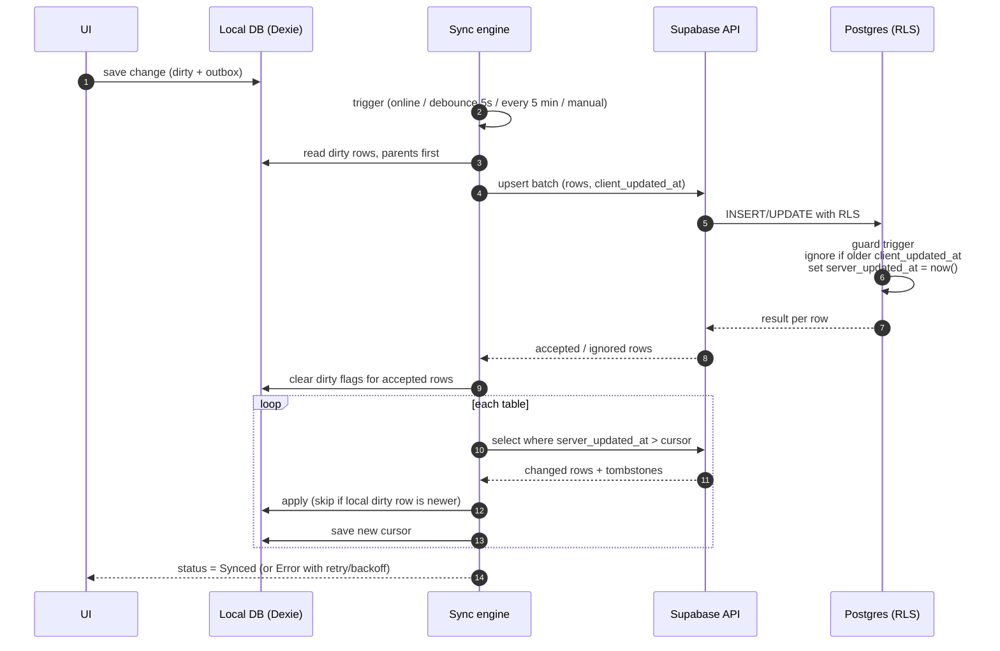

---

## 4. Reference-number reservation

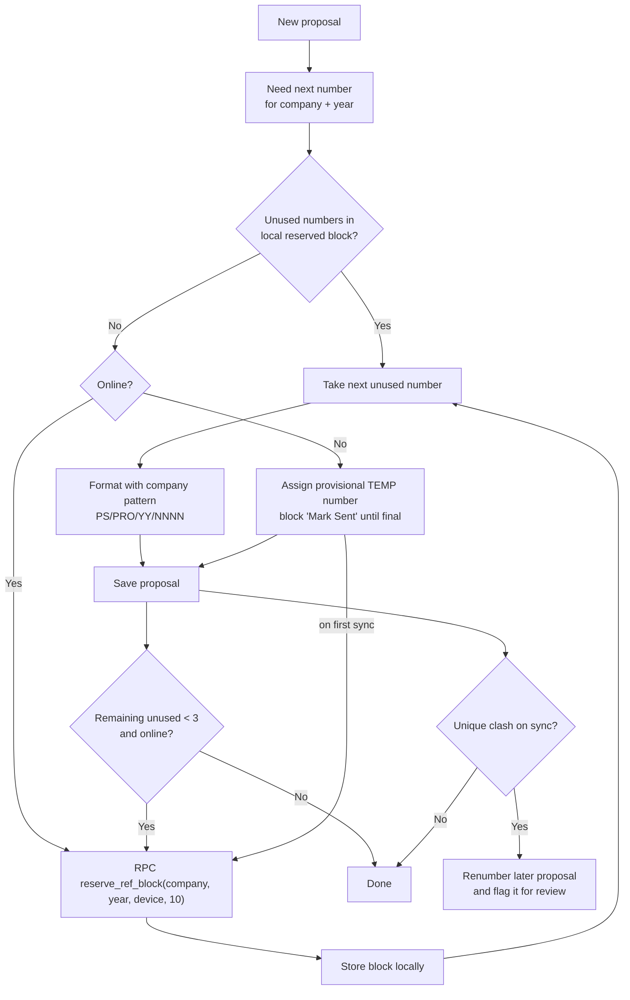

---

## 5. Proposal creation flow

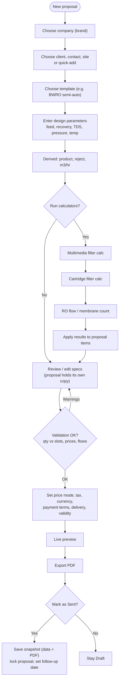

---

## 6. Multimedia filter calculation flow

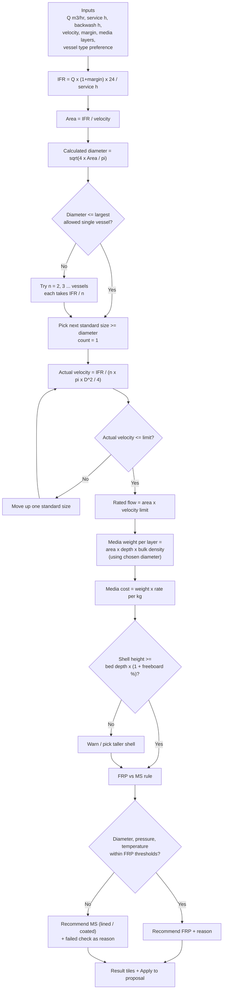

---

## 7. Cartridge filter calculation flow

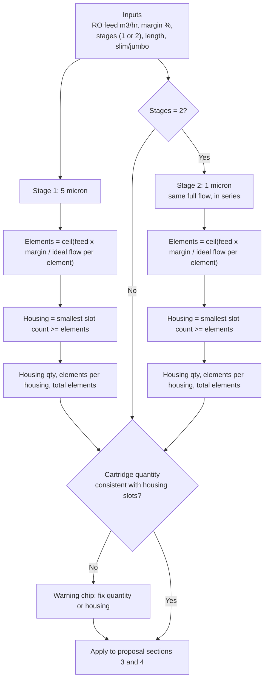

---

## 8. PDF generation pipeline

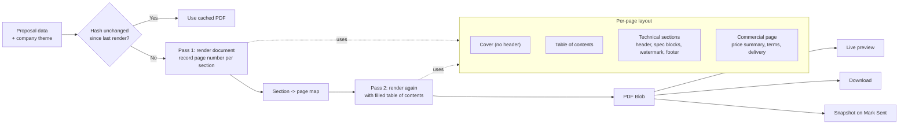

---

## 9. Proposal status state machine

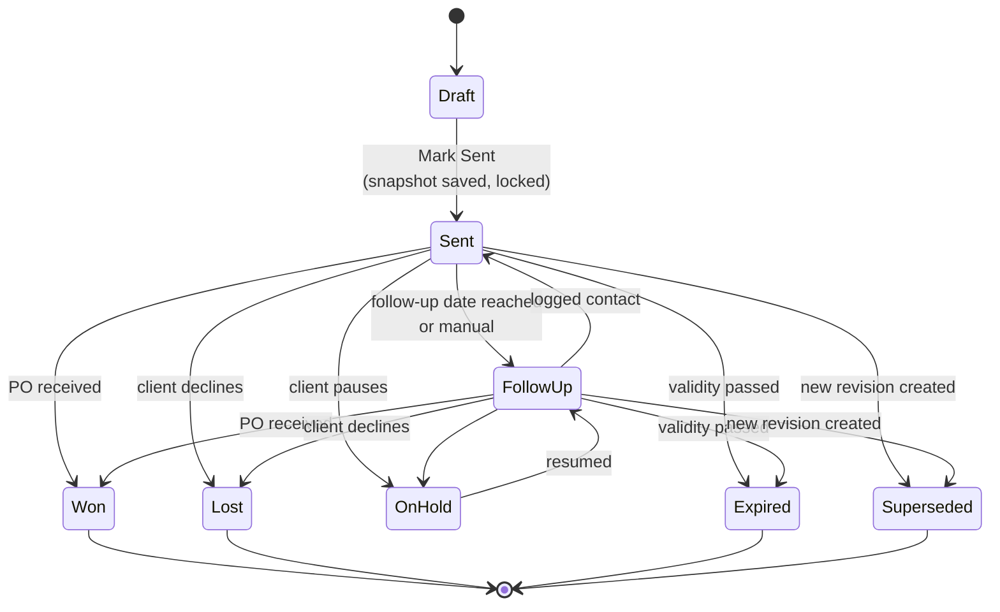

---

## 10. Revision and duplicate flow

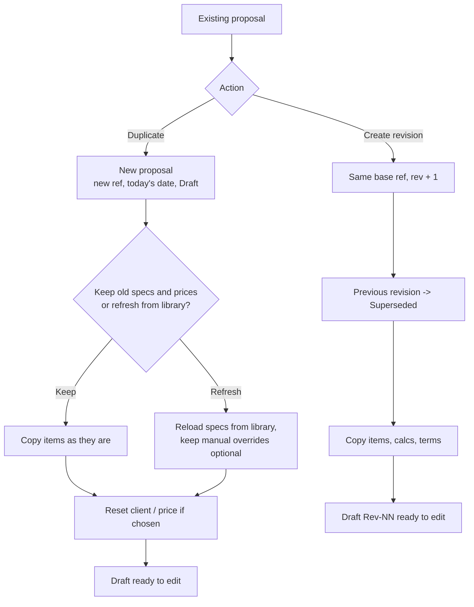

---

## 11. Data model overview

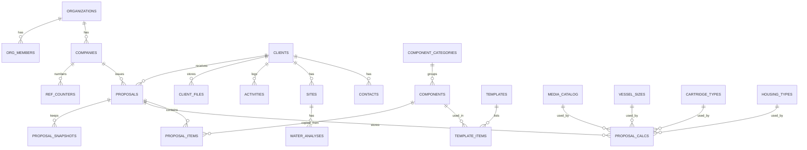

---

## 12. Deployment and CI flow

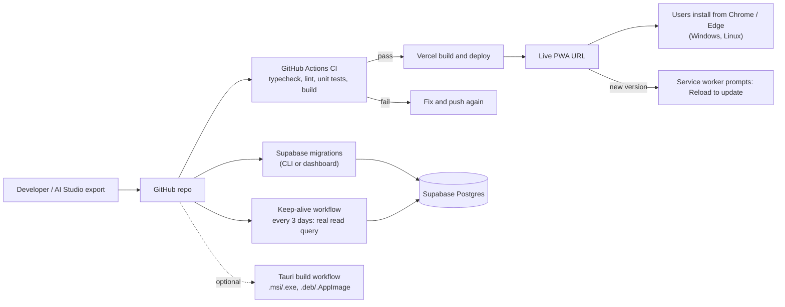
